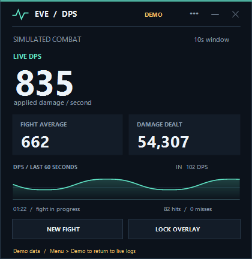

# EVE DPS

A portable Windows overlay for **live applied DPS and fight average DPS** in EVE Online. It reads the combat logs written by your own client and displays a small window above EVE.



## Run

1. Extract the portable package to a writable folder and double-click **EveDps.exe**. If you downloaded the source repository, build it using the instructions below first.
2. Run EVE in **borderless / fixed window or windowed mode**. Exclusive fullscreen is not supported by this desktop overlay.
3. The app detects the Windows Documents folder, including redirected Documents, and watches `EVE\logs\Gamelogs`. Use **... > Settings** to choose a different folder or a specific character.
4. Drag the overlay into position. Click **Lock overlay** to make it click-through, then return to EVE.
5. Use **Ctrl+Alt+D** to unlock it and **Ctrl+Alt+H** to hide or show it. The system tray icon provides the same controls.

The app starts in live mode and waits for **new** combat activity. Existing damage in a log is skipped when you attach, so start it before the fight you want to measure. You can start EVE before or after the overlay. New character sessions are detected automatically.

## What it shows

- **Live DPS:** outgoing damage in the last 10 seconds divided by 10. Set a 1-120 second window in Settings. The full configured denominator is used even at the beginning of a fight.
- **Fight average:** total outgoing damage divided by the inclusive combat duration, `last combat timestamp - first combat timestamp + 1 second`. Incoming hits and misses also define combat activity. The average updates on combat events and remains available after combat stops.
- **Damage dealt:** total outgoing damage for the current fight, including weapon and drone hits recorded in that character's log.
- **Incoming DPS:** damage received over the same live window.
- **Graph:** the last 60 seconds of the live DPS calculation for the current fight.
- **Hits and misses:** outgoing logged hits and outgoing misses.

A gap of **30 seconds** with no parsed damage or miss starts a new fight on the next combat event. You can set the gap from 15-300 seconds. **New fight** clears the current totals immediately. A new character session also clears the totals.

Automatic character selection follows the most recently **started** character session; it does not combine accounts. Choose your character in Settings when multiboxing. The newest 2,000 text log files are considered.

The menu also provides **Demo data on / off** and **Export fight summary** to CSV. Demo mode is visibly labeled and exports identify their source as `demo`.

## Requirements and limits

Windows with .NET Framework 4.x (validated here on the installed .NET Framework 4.8 runtime). No Python, Node, EVE login, API key, administrator access, or installer is needed to run the executable.

This first version parses modern **English combat log messages**. Non-English clients and old narrative log formats are not supported. Log timestamps are interpreted as EVE/UTC time, so the PC clock should be correct. Display updates occur every 250 ms, and new sessions are scanned every 2 seconds; additional delay can come from the EVE client's log flushing.

Only events actually written to the selected character's log can be measured. This is applied damage, not theoretical fitting DPS. A live in-game combat test is still needed: the development machine's existing logs had session headers and navigation messages but no damage events. Parser, timing, tailing, and rotation are verified with generated fixtures; the rendered overlay was visually inspected.

If no numbers appear, confirm that the selected character's current text log is receiving combat entries, the client uses English, and Demo mode is off. Choose the `Gamelogs` folder, not Chatlogs or launcher logs. If a shortcut is already in use, control the overlay through its tray menu.

## Local data and game interaction

The app opens log files read-only with shared access so EVE can continue writing. It uses a separate Windows topmost window. It does not read game memory, inject code, inspect network traffic, scrape client caches, send game input, or make network requests. It stores preferences beside the executable in `settings.xml`; that file and exported summaries are excluded from Git.

This is an independent tool, not a CCP product or an assertion of CCP approval. CCP's [Third Party Policies](https://support.eveonline.com/hc/en-us/articles/8564030965660-Third-Party-Policies) describe its position on third-party applications and overlays. The [PELD project's documentation](https://github.com/ArtificialQualia/PyEveLiveDPS) is another primary implementation reference for combat-log meters and borderless display. This app is an original C# implementation.

## Build and test

From the repository root in PowerShell:

```powershell
.\source\build.ps1
.\source\test.ps1
.\EveDps.exe
```

The build script uses the .NET Framework C# compiler supplied with Windows, includes `source/EveDps.ico`, and writes `EveDps.exe` at the repository root. It requires no package downloads. Close the running overlay before rebuilding.

The test script runs deterministic fixtures and writes `work/test-results.txt`; it does not alter your EVE logs. Its process exit code fails on a failing assertion.

Optional command-line modes:

```powershell
.\EveDps.exe --demo
# GUI executables should be awaited when used in scripts:
Start-Process .\EveDps.exe -ArgumentList '--render-preview', 'preview.png' -Wait
```

`Combat.cs` contains the parser, meter, and incremental shared log reader. `App.cs` contains the overlay, preferences, settings, tray controls, and CSV export. `SelfTests.cs` contains the executable test runner.
